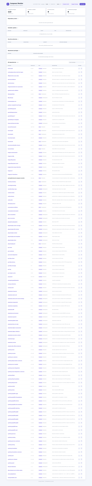

# Laravel Composer Monitor

[](https://packagist.org/packages/laravel-composer-monitor)
[](https://packagist.org/packages/laravel-composer-monitor)
[](https://packagist.org/packages/laravel-composer-monitor)
[](https://laravel.com)
[](https://github.com/mertaydin/laravel-composer-monitor/actions/workflows/tests.yml)
[](LICENSE)


A lightweight Laravel dashboard for monitoring Composer dependency health. Review installed packages, available updates, security advisories, abandoned dependencies and the constraints blocking updates — all from one place.

## Screenshot

The screenshot is captured from the package's real dashboard in a temporary Laravel application by GitHub Actions.



## Features

- **Dependency inventory:** browse installed production and development packages, versions and direct/transitive status.
- **Outdated packages:** identify dependencies with newer releases available.
- **Security monitoring:** review Composer security audit advisories and affected versions.
- **Abandoned packages:** identify packages marked as abandoned and suggested replacements.
- **Update blockers:** inspect dependency constraints that prevent an update.
- **Package inspection:** open installed package details with `composer show` or inspect dependency trees with `composer why`.
- **On-demand diagnostics:** run `composer audit` and review `composer suggests` recommendations in dashboard modals.
- **Dashboard and Artisan command:** run checks from the web interface or CLI.
- **Six dashboard languages:** Turkish, English, Arabic, Spanish, Hindi and Simplified Chinese.
- **Appearance preferences:** light, dark and system themes.
- **Dependency alerts:** configurable update thresholds and watched packages, with dashboard, email, database notification, Slack and Discord delivery.
- **Dashboard access control:** authentication is required by default, with an optional callback for application-specific authorization.
- **Configurable runtime:** choose the Composer executable, timeout and cache.
- **Laravel package discovery:** automatically registers its service provider.

## Requirements

- PHP 8.2 or newer
- Laravel 10, 11, 12 or 13
- Composer 2

## Installation

Install the package with Composer:

```bash
composer require mertaydin/laravel-composer-monitor
```

The dashboard is available at `/composer-monitor` by default. To place it under an existing application panel path, update `route.prefix` in `config/composer-monitor.php`:

```php
'route' => [
    'prefix' => 'panel/super/composer-monitor',
],
```

The dashboard will then be available at `/panel/super/composer-monitor`. Leading and trailing slashes are normalized automatically.

Publish the dashboard stylesheet so it can be served as a same-origin external asset (compatible with strict `style-src` Content Security Policies):

```bash
php artisan vendor:publish --tag=composer-monitor-assets --force
```

Run this command after installing the package and after every package update. The `--force` option is important: Laravel does not overwrite already-published files by default, so without it an older JavaScript file may remain in `public/` even when the Composer package has been updated. The stylesheet and JavaScript are served from `public/vendor/composer-monitor/css/app.css` and `public/vendor/composer-monitor/js/app.js`.

Publish the configuration file to customize the package:

```bash
php artisan vendor:publish --tag=composer-monitor-config
```

## Usage

Run a dependency check from the dashboard or with Artisan:

```bash
php artisan composer-monitor:check
```

The monitor reads your application's `composer.json` and `composer.lock`, then runs Composer's locked audit and outdated checks. It does not install, update or modify your dependencies.

## Dependency check loading state

Selecting **Check now** opens a centered loading dialog with a spinner and animated progress bar while the existing POST/redirect check runs. The submit button is disabled during the request to prevent duplicate scans.

## Language and appearance

The dashboard includes six languages: Türkçe, English, العربية, Español, हिन्दी and 简体中文. Select a language from the dashboard header; the preference is stored in the current session. The appearance selector supports light, dark and system themes.

## Configuration

| Key | Default | Description |
| --- | --- | --- |
| `route.enabled` | `true` | Register the dashboard routes |
| `route.prefix` | `composer-monitor` | Dashboard URL prefix; supports nested paths such as `panel/super/composer-monitor` |
| `route.name` | `composer-monitor.` | Route name prefix |
| `layout` | `null` | Optional Blade layout to extend |
| `composer_binary` | `composer` | Composer executable path |
| `timeout` | `120` | Composer process timeout in seconds |
| `blocker_limit` | `30` | Maximum outdated packages checked for update blockers |
| `cache.store` | Default | Optional Laravel cache store |
| `cache.key` | `composer-monitor:latest` | Cache key |
| `cache.ttl` | `null` | Cache lifetime; null keeps the latest result |

## Access control

The dashboard always uses the `web` and `auth` middleware. For additional application-specific authorization, register a callback using the facade in a service provider:

```php
use Illuminate\\Http\\Request;
use MertAydin\\ComposerMonitor\\Facades\\ComposerMonitor;

public function boot(): void
{
    ComposerMonitor::auth(fn (Request $request): bool =>
        $request->user()?->hasRole('SuperAdmin') ?? false
    );
}
```

The callback receives the current request. Return `true` to allow access or `false` to respond with HTTP 403. The callback is optional; the package's `web` and `auth` middleware always apply.

For production applications, do not expose the dashboard publicly.

## License

This package is open-sourced software licensed under the [MIT license](LICENSE).


The callback is the package's application-specific authorization mechanism. If no callback is registered, access is controlled by the configured route middleware (`web` and `auth` by default).

## Documentation and support

- [Changelog](CHANGELOG.md)
- [GitHub releases](https://github.com/mertaydin/laravel-composer-monitor/releases)
- [Report an issue or request a feature](https://github.com/mertaydin/laravel-composer-monitor/issues)

---

**Dil / Language:** [Türkçe README](README.tr.md) · [English README](README.md)
