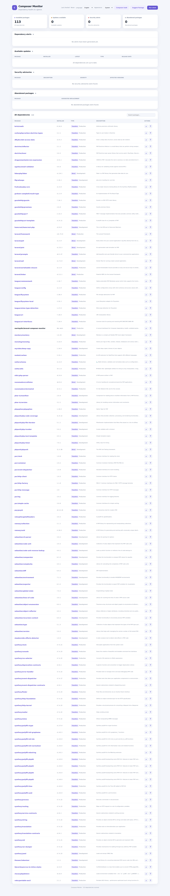

# Laravel Composer Monitor

Composer bağımlılıklarının sağlığını izlemek için hafif bir Laravel yönetim paneli. Kurulu paketleri, mevcut güncellemeleri, güvenlik duyurularını, terk edilmiş bağımlılıkları ve güncellemeleri engelleyen sürüm kısıtlarını tek bir yerden inceleyin.

[](https://packagist.org/packages/mertaydin/laravel-composer-monitor)
[](https://packagist.org/packages/mertaydin/laravel-composer-monitor)
[](LICENSE)
[](https://github.com/mertaydin/laravel-composer-monitor/actions)

## Ekran görüntüsü

Ekran görüntüsü, GitHub Actions tarafından geçici bir Laravel uygulamasında paketin gerçek yönetim panelinden alınır.



## Özellikler

- **Bağımlılık envanteri:** Üretim ve geliştirme paketlerini, sürümlerini ve doğrudan/dolaylı bağımlılık durumunu görüntüleme.
- **Güncel olmayan paketler:** Daha yeni sürümü bulunan bağımlılıkları belirleme.
- **Güvenlik izleme:** Composer güvenlik denetimi duyurularını ve etkilenen sürümleri inceleme.
- **Terk edilmiş paketler:** Kullanımdan kaldırılmış olarak işaretlenen paketleri ve önerilen alternatifleri belirleme.
- **Güncelleme engelleri:** Güncellemeyi engelleyen bağımlılık sürüm kısıtlarını inceleme.
- **Paket inceleme:** `composer show` ile kurulu paket ayrıntılarını, `composer why` ile bağımlılık ağaçlarını görüntüleme.
- **İsteğe bağlı tanılama:** Panel pencerelerinde `composer audit` çalıştırma ve `composer suggests` önerilerini inceleme.
- **Panel ve Artisan komutu:** Kontrolleri web arayüzünden veya CLI üzerinden çalıştırma.
- **Altı panel dili:** Türkçe, İngilizce, Arapça, İspanyolca, Hintçe ve Basitleştirilmiş Çince.
- **Görünüm tercihleri:** Açık, koyu ve sistem temaları.
- **Bağımlılık uyarıları:** Yapılandırılabilir güncelleme eşikleri ve izlenen paketler; panel, e-posta, veritabanı bildirimi, Slack ve Discord ile bildirim.
- **Panel erişim kontrolü:** Varsayılan olarak kimlik doğrulama zorunludur; uygulamaya özel yetkilendirme için isteğe bağlı callback bulunur.
- **Yapılandırılabilir çalışma ortamı:** Composer çalıştırılabilir dosyasını, zaman aşımını ve önbelleği seçme.
- **Laravel paket keşfi:** Service provider otomatik kaydedilir.

## Gereksinimler

- PHP 8.2 veya üzeri
- Laravel 10, 11, 12 veya 13
- Composer 2

## Kurulum

Paketi Composer ile yükleyin:

```bash
composer require mertaydin/laravel-composer-monitor
```

Panel varsayılan olarak `/composer-monitor` adresindedir. Mevcut bir uygulama panelinin altında kullanmak için `config/composer-monitor.php` içindeki `route.prefix` değerini değiştirin:

```php
'route' => [
    'prefix' => 'panel/super/composer-monitor',
],
```

Bu durumda panel `/panel/super/composer-monitor` adresinde açılır. Baştaki ve sondaki eğik çizgiler otomatik normalize edilir.

Katı `style-src` Content Security Policy kurallarıyla uyumlu, aynı kaynaktan sunulan harici asset olarak panel stil dosyasını yayımlayın:

```bash
php artisan vendor:publish --tag=composer-monitor-assets --force
```

Bu komutu paket kurulumundan sonra ve her paket güncellemesinde çalıştırın. Laravel yayımlanmış dosyaların üzerine varsayılan olarak yazmadığından `--force` önemlidir; aksi halde Composer paketi güncellense bile `public/` altında eski JavaScript kalabilir. Stil ve JavaScript dosyaları `public/vendor/composer-monitor/css/app.css` ve `public/vendor/composer-monitor/js/app.js` konumlarından sunulur.

Yapılandırmayı özelleştirmek için dosyayı yayımlayın:

```bash
php artisan vendor:publish --tag=composer-monitor-config
```

## Kullanım

Panelden veya Artisan ile bağımlılık kontrolü başlatın:

```bash
php artisan composer-monitor:check
```

İzleyici uygulamanızın `composer.json` ve `composer.lock` dosyalarını okur; Composer'ın kilitli audit ve outdated kontrollerini çalıştırır. Bağımlılıklarınızı yüklemez, güncellemez veya değiştirmez.

## Bağımlılık kontrolü yükleniyor durumu

**Şimdi Kontrol Et** seçildiğinde mevcut POST/redirect kontrolü sürerken ortalanmış bir yükleniyor penceresi, spinner ve animasyonlu ilerleme çubuğu açılır. Yinelenen taramaları önlemek için istek boyunca gönder düğmesi devre dışı bırakılır.

## Dil ve görünüm

Panel Türkçe, İngilizce, Arapça, İspanyolca, Hintçe ve Basitleştirilmiş Çince dillerini içerir. Panel başlığından dil seçilebilir; tercih mevcut oturumda saklanır. Görünüm seçicisi açık, koyu ve sistem temalarını destekler.

## Yapılandırma

| Anahtar | Varsayılan | Açıklama |
| --- | --- | --- |
| `route.enabled` | `true` | Panel rotalarını kaydeder |
| `route.prefix` | `composer-monitor` | `panel/super/composer-monitor` gibi iç içe yolları destekleyen panel URL öneki |
| `route.name` | `composer-monitor.` | Rota adı öneki |
| `layout` | `null` | Genişletilecek isteğe bağlı Blade layout |
| `composer_binary` | `composer` | Composer çalıştırılabilir dosyasının yolu |
| `timeout` | `120` | Composer işlemi zaman aşımı (saniye) |
| `blocker_limit` | `30` | Güncelleme engelleri için kontrol edilecek en fazla güncel olmayan paket |
| `cache.store` | Varsayılan | İsteğe bağlı Laravel cache store |
| `cache.key` | `composer-monitor:latest` | Önbellek anahtarı |
| `cache.ttl` | `null` | Önbellek süresi; null son sonucu korur |

## Erişim kontrolü

Panel her zaman `web` ve `auth` middleware'lerini kullanır. Uygulamaya özel ek yetkilendirme için bir service provider içinde facade callback'i kaydedin:

```php
use Illuminate\Http\Request;
use MertAydin\ComposerMonitor\Facades\ComposerMonitor;

public function boot(): void
{
    ComposerMonitor::auth(fn (Request $request): bool =>
        $request->user()?->hasRole('SuperAdmin') ?? false
    );
}
```

Callback mevcut isteği alır. Erişime izin vermek için `true`, HTTP 403 döndürmek için `false` döndürün. Callback isteğe bağlıdır; paketin `web` ve `auth` middleware'leri her zaman uygulanır.

Üretim ortamlarında paneli herkese açık şekilde sunmayın.

## Lisans

Bu paket [MIT lisansı](LICENSE) altında açık kaynak olarak sunulur.

## Dokümantasyon ve destek

- [Değişiklik günlüğü](CHANGELOG.md)
- [GitHub sürümleri](https://github.com/mertaydin/laravel-composer-monitor/releases)
- [Hata bildir / özellik iste](https://github.com/mertaydin/laravel-composer-monitor/issues)
